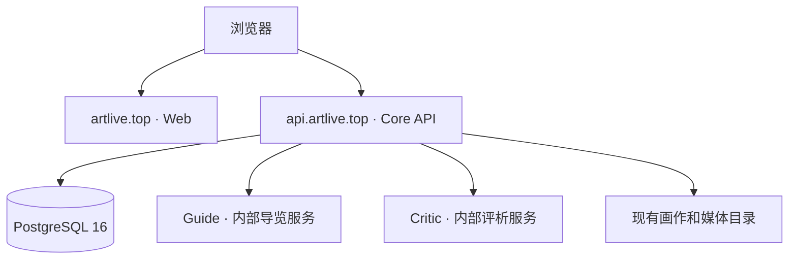

# 部署架构

当前发布范围是 ArtLIVE 国画项目。Web、Core、AI 保持独立仓库，Deploy
管理 R25 发布配置和跨组件版本约束。日常开发通过 PR 合入 `main`，阶段版本
通过同仓库 `main` 到 `release` 的 PR 提升。

公开页面由 Web 提供，浏览器使用 `https://api.artlive.top` 获取目录和媒体。
Guide、Critic 由 Core 通过内部接口调用。R25 当前运行目录及版本核验说明见
[R25 运行映射](r25-runtime.md)。

不同仓库的 Actions concurrency 不能互相串行化。涉及生产切换的流程必须持有
同一个服务器发布锁，再核验当前版本、进程身份和数据兼容性。

## 保留的旧模板

根目录 `docker-compose.yml` 和 `nginx/default.conf` 描述旧音乐项目：
Web 3000、SQLite Core 5000、VMM 5001、Vision 5002。
所有服务归入 `legacy` profile，必须明确选择后才会启动。
它们不描述 R25，也不能用于重启现有国画项目。

模型、数据库、图片、生成媒体和真实环境文件保留在服务器的数据目录，
不纳入代码制品或常规发布的文件替换范围。
